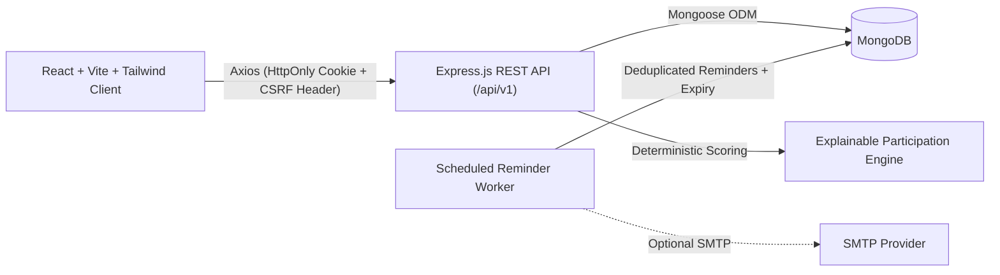

# OpportunityLoop

**Discover. Participate. Grow.**

OpportunityLoop is a MERN-stack student opportunity and participation hub built for college students across India in **all academic disciplines** — Engineering and Technology, MCA/CS/IT, Science and Research, Commerce and Management, Arts and Humanities, Law, Design and Media, Medicine and Allied Disciplines, Education, and other UG/PG programs.

Its core differentiator is the **Explainable Participation Engine**, which evaluates published eligibility criteria against each student's profile, calculates a transparent weighted match score, flags missing information rather than guessing eligibility, and guides students from discovery to preparation checklists, external registration, team matching, and portfolio outcomes.

---

## Features

- **Multi-role RBAC**: Student, Organizer, and Administrator roles enforced on the Express backend.
- **Explainable Participation Engine**: Deterministic eligibility classification (`eligible`, `ineligible`, `unknown`), configurable 0–100 weighted scoring, positive match reasons, missing-data disclosures, and next-step guidance.
- **MongoDB-Backed Search & Filtering**: Keyword search, category, mode (`online`/`offline`/`hybrid`), free/paid, state, discipline, degree level, beginner-friendly, historical expired toggle, sorting (`deadline`, `newest`, `relevance`), and bounded pagination.
- **Bookmarks & Participation Journey**: Idempotent bookmarks, preparation checklists, validated state transitions (`interested` → `registered` → `preparing` → `submitted` → `participated` → `won` / `withdrawn`), and an Achievement Portfolio distinguishing self-reported from organizer-confirmed records.
- **Team Discovery & Requests**: Opportunity-linked team requests, complementary skill listings, capacity enforcement, leader/applicant approval workflow, and privacy protection (no public email exposure).
- **Deadline Reminders & Expiration Detection**: Deduplicated in-app deadline reminders with optional SMTP email delivery and automatic expired-opportunity detection.
- **Organizer & Admin Moderation Workflows**: Draft/submit/verify/reject lifecycle, student reporting modal, user moderation, category & platform settings management, Recharts analytics, and immutable audit logs.

---

## Architecture Overview



---

## Prerequisites

- Node.js 20+ (tested on Node v24.16.0) and npm 10+
- MongoDB 7.0+ (local MongoDB instance, MongoDB Atlas, or Docker Compose)
- Docker & Docker Compose (optional, for containerized local setup)

---

## Installation & Environment Setup

1. Clone or open the repository root and install dependencies for root, server, and client:
   ```bash
   npm install
   npm --prefix server install
   npm --prefix client install
   ```
   *(On Windows PowerShell where `npm.ps1` execution policy is restricted, use `npm.cmd`.)*

2. Copy environment templates:
   ```bash
   cp .env.example .env
   cp server/.env.example server/.env
   cp client/.env.example client/.env
   ```

3. Update `server/.env` with your MongoDB URI (`MONGODB_URI`) and a strong `SESSION_SECRET`.

---

## Database Setup & Demo Seeding

1. Ensure MongoDB is running (or start MongoDB via Docker Compose).
2. Seed clearly labelled demo categories, settings, sample student/organizer accounts, and 10 demo opportunities across disciplines:
   ```bash
   npm run seed
   ```
3. To create a local development administrator using environment variables (never hardcoded):
   ```bash
   # Set DEV_ADMIN_NAME, DEV_ADMIN_EMAIL, DEV_ADMIN_PASSWORD in server/.env or shell
   npm --prefix server run create-dev-admin
   ```
4. To reset development data safely (refuses `NODE_ENV=production`):
   ```bash
   npm run seed:reset
   ```

---

## Running Locally

### Option A: Local Node Processes (with External/Local MongoDB)
Start both API (`http://localhost:5000`) and Vite client (`http://localhost:5173`):
```bash
npm run dev
```
Or run separately:
```bash
npm run dev:server
npm run dev:client
```

### Option B: Zero-Install In-Memory Dev Mode (No Local MongoDB Required)
If MongoDB is not installed locally, start the API with an auto-seeded in-memory MongoDB instance (`mongodb-memory-server`, development only):
```bash
npm run dev:memory
```
*(Data resets when the process stops; demo student `student.demo@example.com` and demo organizer `organizer.demo@example.com` with password `DemoPass@123` are seeded automatically.)*

### Option C: Docker Compose
```bash
docker compose up --build
```
- Web UI: `http://localhost:8080`
- API Health: `http://localhost:5000/api/v1/health`

---

## Testing & Evaluation Commands

- Run backend integration & API tests (Vitest + Supertest + `mongodb-memory-server`):
  ```bash
  npm run test:server
  ```
- Run frontend component & workflow tests (Vitest + React Testing Library):
  ```bash
  npm run test:client
  ```
- Run recommendation engine evaluation script (compares personalized ranking vs chronological baseline):
  ```bash
  npm run evaluate:recs
  ```
- Build frontend for production:
  ```bash
  npm run build
  ```

---

## Documentation Index

- [Architecture](docs/architecture.md)
- [Database Schema](docs/database-schema.md)
- [API Specification](docs/api-specification.md)
- [Security Architecture](docs/security.md)
- [Recommendation Engine](docs/recommendation-engine.md)
- [Testing Strategy](docs/testing.md)
- [Deployment Guide](docs/deployment.md)
- [Known Limitations](docs/known-limitations.md)

